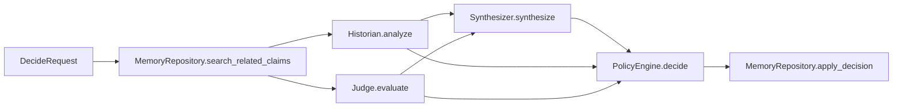

# Parallel work guide and main-branch compatibility

Audit target: `origin/main` at `91bb675` (merge of PR #12). This note covers that commit's
compatibility rules. Sai Chetan Sprint 3–4 Judge work builds on top of later `main` merges;
the ownership and Judge-request rules below still apply.

The council pipeline on that commit is compatible: one request, one write, four owners behind shared protocols. A short list of hardcoded defaults will make results disagree if people run different modes.

## Shared flow everyone must keep

One request, one write, four owners behind protocols in `src/sekf/contracts/models.py` and `src/sekf/memory/interface.py`. `src/sekf/api/orchestrator.py` is the only place that calls roles and then `apply_decision`.

The Judge request contains the candidate and evidence only. It does not receive the Historian output, the gold label, or the final action. That split is intact on main.

Parallel rule: each person edits only their module and talks to the others through the protocol. Do not change `src/sekf/contracts/`, policy rule order, or `Thresholds` defaults during the two-day push. Those files are the shared surface.

- Krishna: `src/sekf/memory/` and, when added, `baselines/direct_storage`, `baselines/latest_write_wins`, `baselines/static_rag`. Those three baseline packages are not on main yet.
- Mahalakshmi: `src/sekf/historian/`, `src/sekf/synthesizer/`, `datasets/ANNOTATION_GUIDE.md`, temporal cases.
- Sai Chetan: `src/sekf/judge/`, `src/sekf/providers/`, `src/sekf/baselines/single_judge/`, `src/sekf/baselines/generic_ensemble/`.
- Shailen: `src/sekf/policy/engine.py`, `src/sekf/api/`, and the experiment runner. `src/sekf/evaluation/__init__.py` is empty on main. `/v1/baselines` and `/v1/experiments` are not registered. `src/sekf/api/app.py` says they come in a later sprint.

Review pairs stay Krishna with Mahalakshmi, and Sai Chetan with Shailen. Two people can merge in parallel when they avoid `contracts/`, `pyproject.toml`, `Makefile`, and the API router.

## One shared run mode

Record these in every result file. Different values are a different experiment.

- `SEKF_MEMORY=sql` for any run that checks claim status after commit. Tests that only need a recorded bundle may use `memory`.
- `SEKF_HISTORIAN=deterministic` and `SEKF_SYNTHESIZER=deterministic` for offline CI.
- `SEKF_PROVIDER=fake` for CI. `openai` only for a live pilot, with model, prompt hash, temperature, and seed stored per case.
- `SEKF_HISTORIAN=llm` only when the case needs source-conflict detection, and that choice is written on the run.
- Each person uses their own `SEKF_DB_URL`. The default in `src/sekf/memory/sql.py` is `sqlite:///./data/sekf.sqlite3`, so two API processes in one clone share one file.
- `single-judge-v1` and `policy-v1` stay different version strings. They identify different systems.

## What already agrees

- Historian, Judge, Synthesizer, Policy, and both repositories implement the protocol methods the orchestrator calls.
- SQL and the in-memory store both reject a stale `memory_before` and both replay by `decision_id`.
- `src/sekf/historian/llm.py` runs the deterministic historian first and may only upgrade a finding to `SOURCE_CONFLICT` or swap duplicate for paraphrase. Time math stays in the rules.
- Dev cases load through the same Pydantic models. `tests/unit/test_dataset_consistency.py` checks labels against the annotation guide, not by calling the policy.
- Unknown `SEKF_PROVIDER`, `SEKF_MEMORY`, `SEKF_HISTORIAN`, and `SEKF_SYNTHESIZER` values fail at startup. There is no silent fallback.
- A live call with `run_config.model` of `fake/none` is replaced by `SEKF_LLM_MODEL` or `gpt-4o-mini` inside `complete_json`.

## Mismatches on main

These are the places a teammate will get a different action from the same case.

1. Two stores, two meanings of commit. `src/sekf/memory/in_memory.py` records the bundle and leaves claim status unchanged. `src/sekf/memory/sql.py` sets `ACTIVE`, `SUPERSEDED`, `QUARANTINED`, `REJECTED`, or `CANDIDATE`. `SEKF_MEMORY` defaults to `sql`. A demo on `memory` reports a successful promote while later searches still see the old claims.

2. Default Judge cannot score the dataset. `src/sekf/judge/fake.py` returns `SUPPORTED` at confidence `0.9` when `object_text` is a substring of some evidence, otherwise `INSUFFICIENT_EVIDENCE`. It never returns `REFUTED`, `MIXED_EVIDENCE`, or `INVALID_INPUT`. With the default `SEKF_PROVIDER=fake`, gold reject and mixed cases cannot match the council. CI should keep this fake. Shared numbers need the live Judge or a fixture Judge, and the run file must say which.

3. Default Historian never emits `SOURCE_CONFLICT`. `src/sekf/historian/deterministic.py` documents that limit. Policy rule R9 and the SQL conflict set both handle `SOURCE_CONFLICT`. Gold cases `datasets/dev/source-similar-01.json` and `datasets/dev/shailen/shailen-source-similar-01.json` use that label. On the default historian those cases will not reproduce the gold conflict type. `SEKF_HISTORIAN=llm` is the path that can add it.

4. The same confidence numbers are copied in four places. Change one and the others still assume the old cutoff.
   - `src/sekf/contracts/models.py` `Thresholds`: support `0.80`, refute `0.80`, historian `0.70`, source `0.60`, veto `0.80`.
   - `src/sekf/historian/deterministic.py`: `CONFIDENT = 0.90`, `NO_EVIDENCE = 0.80`, `AMBIGUOUS = 0.50` (chosen so it sits under `0.70` and rule R6 escalates).
   - `src/sekf/historian/llm.py`: `DISAGREEMENT_CONFIDENCE = 0.50`, `MAX_RELIABILITY_SPREAD = 0.30`.
   - `src/sekf/synthesizer/deterministic.py`: `VETO = 0.85`, `JUDGE_SURE = 0.80`, `MIN_EXTRACTOR_CONFIDENCE = 0.50`.
   - `datasets/ANNOTATION_GUIDE.md` uses reliability below `0.6` as the quarantine cutoff.

5. Gold labels and policy R4 use different refute rules. The consistency test requires gold `REFUTED` to pair with gold `REJECT`. Policy R4 in `src/sekf/policy/engine.py` quarantines `REFUTED` when confidence is under `0.80`. The dataset cannot contain the policy's weak-refute case. Score that as a policy-versus-label difference. Do not "fix" the guide by calling the policy.

6. `prompt_hash` means two different things. Deterministic historian and synthesizer hash the version string (`sha256(PROMPT_VERSION.encode())`). LLM roles hash the file bytes via `src/sekf/providers/prompts.py`. A manifest that compares those hashes across `SEKF_HISTORIAN=deterministic` and `llm` is comparing different objects.

7. Cost is `0` for every model other than `gpt-4o-mini`. `src/sekf/providers/openai_compatible.py` prices only that id (`0.15` / `0.60` per million). ADR 0002 and 0003 say this is deliberate. A Sprint 3 model sweep records free tokens unless both `SEKF_LLM_INPUT_COST_PER_MTOK` and `SEKF_LLM_OUTPUT_COST_PER_MTOK` are set. Efficiency tables would then understate cost.

`CommitBundle.episode` exists, and `DecideRequest` has no episode field, so API commits store no episode. That is unused surface, not a broken path.

LLM `assessment_id` values use `uuid4()` on purpose in the Judge. The stable identity is `decision_id` / `request_hash`. A committed retry returns the stored bundle.

## Not on main, so do not treat them as done

- Krishna's three storage baselines.
- Shailen's experiment runner, bootstrap archive, and baseline/experiment HTTP routes.
- `datasets/test/`.
- Docker.

Sprint 3 ablations wait until the runner exists and every system is invoked through `Governance` or the baseline `decide` method with the same `RunConfig`. Until then, each owner can still add cases and error notes without touching another module.
