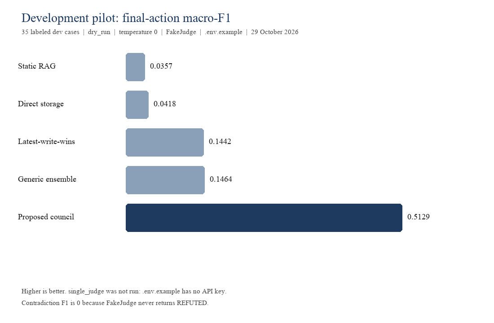

# Development pilot, 29 October 2026

Git commit recorded at run time: `d660a7ffae72101eb6082864c2f7bebe51eb03e2`.
Split: `dev`. Cases loaded: 35. Mode: `dry_run`. Temperature: 0. Seed: 0.
Env files loaded: .env.example.
Live API used: no.
Macro-F1 averages F1 over the seven final actions that appear in the gold labels or the predictions. Promotion precision and recall use PROMOTE. Revision accuracy is the fraction of gold REVISE cases that returned REVISE. Contradiction F1 uses Judge label REFUTED as the positive class and is reported only when the system returns a Judge label.
These numbers are a development pilot. They are not a held-out test result, and prompts were not changed to improve them.

`.env.example` was loaded. `SEKF_PROVIDER` is `fake` and `SEKF_LLM_API_KEY` is empty, so the provider refused a live call. `single_judge` stays not run until `.env` has a key.

| System | n | Final-action macro-F1 | Promotion precision | Promotion recall | Revision accuracy | Contradiction F1 | Median latency (ms) | LLM calls | Tokens | Cost (USD) |
| --- | --- | --- | --- | --- | --- | --- | --- | --- | --- | --- |
| direct_storage | 35 | 0.0418 | 0.1714 | 1.0000 | 0.0000 | n/a | 0 | 0 | 0 | 0.0000 |
| latest_write_wins | 35 | 0.1442 | 0.3846 | 0.8333 | 1.0000 | n/a | 0 | 0 | 0 | 0.0000 |
| static_rag | 35 | 0.0357 | n/a | 0.0000 | 0.0000 | n/a | 0 | 0 | 0 | 0.0000 |
| single_judge | not run |  |  |  |  |  |  |  |  |  |
| generic_ensemble | 35 | 0.1464 | 0.2500 | 1.0000 | 0.0000 | 0.0000 | 0 | 0 | 0 | 0.0000 |
| proposed_council | 35 | 0.5129 | 0.6667 | 1.0000 | 0.8571 | 0.0000 | 0 | 0 | 0 | 0.0000 |

## What each row means

- direct_storage: specified rule in this script. Package is not in the repository. Every parsed candidate is PROMOTE.
- latest_write_wins: specified rule in this script. Package is not in the repository. REVISE when a related ACTIVE claim is older than the candidate; KEEP_EPISODIC when a related ACTIVE claim is not older; otherwise PROMOTE.
- static_rag: specified rule in this script. Package is not in the repository. Retrieval may answer a question, but it never writes governed memory, so the scored memory action is KEEP_EPISODIC.
- single_judge: not run. `.env.example` leaves SEKF_LLM_API_KEY empty and SEKF_PROVIDER=fake. Copy it to `.env` and set a key to run this row.
- generic_ensemble: three FakeJudge votes. No network. A live three-call panel was not run, to keep the live budget on the council and single_judge.
- proposed_council: DeterministicHistorian, FakeJudge, DeterministicSynthesizer, policy-v1, dry_run. No network.
